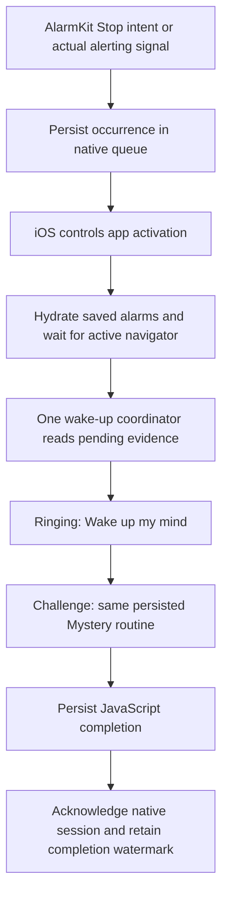

# iOS AlarmKit wake-up handoff

Implemented on `v3`, initially following `e96550d`, with final review fixes following `dc0c2b6`. No merge into `main`, dependency upgrade, entitlement change, or change to volume, audio preparation, Mystery configuration, or mission deadlines.

## Final review fixes

Two further issues were confirmed in `dc0c2b6`: an accepted router call could leave an in-flight request pending forever without committing a route, and older-registration recovery was skipped whenever any native pending handoff existed.

The coordinator now records the target alarm, session, occurrence, expected `/ringing` route and monotonic request start. A five-second **active-app-time** watchdog runs independently of native lookups. A return from `push`/`replace` is only a request; matching route parameters confirm success. Backgrounding cancels the timer and pauses its remaining budget. Matching commits, completion, explicit cancellation, snooze, discarded targets and superseding deliveries cancel the old watchdog. A slow commit can clear an error without issuing another request. A matching challenge already in progress keeps its mission progress.

Immediate navigation exceptions and commit timeouts expose **Open wake-up screen**. The boot route renders progress rather than a blank view. The existing focused-screen error layer also shows the retry over ordinary screens and native modals; unfocused screens do not expose duplicate actions. Failure retains the native handoff and original Mystery snapshot. Polls, duplicate callbacks, route changes and resume do not automatically retry a failed request. Explicit retry takes priority over callbacks arriving during a pending lookup and replaces the destination; Expo Router's existing occurrence-specific singular option deduplicates queued actions for the same alarm/session/event.

Every resolution independently checks actual AlarmKit `.alerting` registrations, even with a nonempty pending queue. Saved registration IDs identify unmatched older alarms for native `captureAlertingWakeup` confirmation. After capture, records merge by registration **and** occurrence identity, keeping original positions and appending recovered occurrences in native order. One failed capture does not skip other alarms. Lookup or post-capture reread failures preserve existing valid records and emit `handoff.observe.deferred`/`handoff.capture.deferred` diagnostics. Native completion watermarks and JavaScript completion/cancellation markers remain authoritative; elapsed schedule times never manufacture a delivery.

This follow-up changes only `src/utils/wake-handoff.ts`, its unit tests, `src/components/wake-handoff-router.tsx`, `src/app/index.tsx`, `src/components/screen-error-layer.tsx`, `src/services/wake-handoff.ts`, `scripts/ios-handoff.test.cjs` and this report. There are no new native APIs, Swift edits, scheduling changes, dependencies or entitlements. It uses the durable native bridge from `dc0c2b6`; a build that predates that bridge still needs the native rebuild described below.

## Findings and evidence

These weaknesses were **confirmed by source inspection**. They explain loss and routing opportunities, but none establishes which failure occurred on the reported iPhone without device logs.

| Finding | Consequence |
| --- | --- |
| The Stop intent stored one alarm ID in `UserDefaults`. | Separate alarms could overwrite each other; the value identified neither an occurrence nor a timeout/snooze session. |
| `consumePendingAlarm` removed the value on read. The newer `activeAlarm` path avoided this, but the compatibility path did not. | A legacy lookup could erase evidence before navigation succeeded. |
| Index and the root layout performed independent asynchronous lookups and redirects. Index treated lookup errors as an empty result. | A transient native failure could open ordinary tabs, and two routing owners could race. |
| Warm routing synthesized the same `${alarmId}:active` identifier each day. Its iOS route guard also treated an already visible wake-up for that alarm as current. | Daily occurrences were not represented accurately at the navigation boundary. |
| The root layout processed multiple native alarms in a loop. | Later navigation could replace an earlier alarm instead of retaining an independent pending queue. |
| `AlarmSound` cancelled the mission safety alarm and stopped the system alarm during mount/focus. | Native playback could be stopped before an explicit user action; suspension during that asynchronous transfer could leave a gap. |
| A stored mission deadline alone caused a restart and cancellation. | An expired timestamp was treated as delivery evidence, and routing could stop an alerting backup. |
| There was no host `AppIntentsPackage` declaration for the native framework's intent. | Intent metadata discovery was not explicitly wired through the app target. Whether this caused missing Stop execution on a device is **unverified**. |

**Plausible, unverified device causes:** iOS delaying activation while locked; the intent not being delivered or discovered in a particular app/lock state; suspension between activation, native stopping and JavaScript playback. Linux mocks cannot confirm these conditions.

## Supported activation behavior

Apple's iOS 26 [`supportedModes`](https://developer.apple.com/documentation/appintents/appintent/supportedmodes) API supports background execution followed by deferred foreground activation. `OpenDaybreakIntent` now declares `[.background, .foreground(.deferred)]`. It durably writes the handoff before returning. Under the documented [deferred mode](https://developer.apple.com/documentation/appintents/intentmodes/foregroundmode/deferred), the system requests the foreground transition at the end of the action when the intent does not explicitly request an earlier transition.

The host app includes the framework's intent package through prebuild, following Apple's [framework intent discovery guidance](https://developer.apple.com/documentation/appintents/configuring-the-runtime-behavior-of-your-app-intents). `LiveActivityIntent` executes in the host app; no widget extension or new App Group is introduced.

This cannot force an unlock or override iOS activation policy. The application guarantee is that **persisted Stop or actual alerting evidence remains pending until explicit completion/cancellation and resumes when Refresh is available**. Native `alarmUpdates` and current `.alerting` observations provide additional supported recovery evidence. As described in Apple's [AlarmKit scheduling documentation](https://developer.apple.com/documentation/alarmkit/scheduling-an-alarm-with-alarmkit), Stop and alarm state are native system actions; JavaScript does not infer an AlarmKit delivery solely from elapsed clock time. If iOS delivers neither the intent nor an observable alerting signal while the app is terminated, there is no supported evidence from which this code can reconstruct a missed Stop. Physical testing must establish delivery in those states.

## Final flow

### Native persistence and identity

`DaybreakWakeHandoff` stores an atomic JSON queue in Application Support, guarded by an in-process lock and a file lock. Writes are flushed before success is returned. The directory, lock and data use protection until first user authentication, permitting later locked-device access after the first unlock following reboot. Access before that first unlock still needs device verification; read/write failures propagate and are logged rather than being interpreted as an empty queue.

Each new registration records its app alarm ID, schedule, delivery kind and optional original session ID. An occurrence is the native registration ID plus its associated scheduled timestamp. Schedule arithmetic **only associates an actual Stop/alerting signal** with an occurrence; it never triggers a wake-up by itself. Distinct alarms and daily occurrences occupy independent records. Duplicate signals merge into the same occurrence. Repeating registrations keep completion watermarks so late duplicate callbacks cannot recreate completed occurrences.

Timeouts and snoozes get their own delivery/occurrence IDs while carrying the original v3 wake-session ID. A timeout cannot reroll gameplay or dua order. Snooze defers existing pending deliveries rather than deleting them, while the actual snooze delivery and subsequent mission timeouts remain routable. Existing native cancellation of a schedule is kept separate from acknowledgement of its pending wake-up.

The old UserDefaults value is imported once. Compatibility reads, including the legacy-named `consumePendingAlarm`, are non-destructive. Same-day legacy Stop/observation/import evidence is merged, with legacy completion watermarks suppressing delayed duplicate callbacks. Legacy Mystery handoffs adopt an existing saved v3 session. Registrations created before this build lack the new native schedule metadata: old intent payloads remain accepted, and observed old alerting registrations can be linked using their saved JavaScript registration IDs. Exact historical delivery timestamps cannot be recovered retroactively; re-saving an alarm in the new native build attaches the complete metadata. Existing alarms are not automatically removed or rescheduled.

### Routing and completion

The root hook owns both boot and foreground resolution; index only waits for its result. Resolution is serialized, checks lifecycle again after native reads, and waits for hydration and the root navigator. Read failures retain pending evidence and present a retry on the boot route instead of silently redirecting home.

Navigation is guarded until the requested wake-up route commits. Duplicate callbacks do not push another screen or reset challenge progress. Thrown navigation errors and silent commit failures retain the handoff and require an explicit retry, with a visible recovery action on boot and other focused screens. The watchdog counts active time only. Independent sessions are presented in order, with the currently active session kept together.

Completion is written to AsyncStorage before native acknowledgement. If native cleanup fails, the coordinator suppresses the completed session and retries acknowledgement. Failed older acknowledgements survive completion of later mornings; successful cleanup compacts those failure markers. Explicit deletion records a cancellation marker before the coordinator clears that alarm's handoffs. Missing saved data without such a marker leaves a durable handoff recoverable and reports an error; absence alone is not treated as consent to delete evidence.

`AlarmSound` does not stop native playback on mount/resume and waits while a matching native delivery is alerting. The explicit **Wake up my mind** action transfers ownership into challenges; completing missions remains required. Backup cancellation on route cleanup preserves an already alerting safety alarm. Sixty-second gameplay and five-minute Fajr limits, volume/ramp options, sound preparation and Android service playback remain intact.

## Changed files

| File | Purpose |
| --- | --- |
| `modules/daybreak-alarm-kit/ios/DaybreakWakeHandoff.swift` | Atomic native queue, registration/occurrence/session mapping, legacy import, snooze deferral, completion watermarks and hashed diagnostics. |
| `modules/daybreak-alarm-kit/ios/DaybreakAlarmKitModule.swift` | Deferred intent mode, intent package export, durable Stop/alerting capture, lifecycle events and bridge operations. |
| `plugins/with-alarm-handoff.cjs` | Include the framework's intent metadata in the generated Swift app target. |
| `app.json` | Enable that iOS prebuild plugin. |
| `src/utils/wake-handoff.ts` | Pure, testable routing coordinator shared by cold and warm starts. |
| `src/services/wake-handoff.ts` | Native candidate adapter, legacy recovery, timeout association and Android snooze compatibility. |
| `src/components/wake-handoff-router.tsx` | Root lifecycle/native listeners, watchdog observations, singular destination identity and shared retry UI. |
| `src/components/screen-error-layer.tsx` | Expose navigation retry on the focused screen, including native modals. |
| `src/app/_layout.tsx` | Replace the competing layout routing loop with the coordinator. |
| `src/app/index.tsx` | Wait for authoritative resolution; show recoverable lookup failure. |
| `src/services/alarm-kit.ts` | Types for durable native handoff operations and delivery metadata. |
| `src/services/scheduler.ts` | Pass original session/delivery kind to iOS; explicit stop includes matching mapped snooze deliveries. |
| `src/services/mission-timeout.ts` | Persist original session with safety deliveries; preserve alerting backups during route cleanup. |
| `src/components/use-mission-reminder.ts` | Carry session identity and retain expired/alerting backups until explicit action. |
| `src/components/alarm-sound.tsx` | Remove native stopping from mount/resume; retain existing playback settings. |
| `src/screens/wake-up.tsx` | Stop native delivery on explicit Wake action and pass occurrence identity into completion. |
| `src/state/app-state.tsx` | Persist completion/cancellation evidence, preserve snooze identity, use per-alarm native activity and retain legacy routines. |
| `src/utils/wake-handoff.test.ts` | Mocked coordinator tests for lifecycle, race, identity and routing failures. |
| `scripts/ios-handoff.test.cjs` | Execute real native adapter, provider and timeout service against mocked native/storage boundaries. |
| `scripts/ios-alarm.test.cjs` | Update mount/resume audio ownership regression tests. |
| `plugins/with-alarm-handoff.test.cjs` | Intent package injection and idempotence test. |
| `package.json` | Include new tests in the existing unit command. |
| `docs/ios-alarm-handoff.md` | Findings, implementation, verification and remaining device checks. |

## Verification

- `npm run typecheck`: passed.
- `npm run test:unit`: 144 passed. Includes all eleven requested mocked scenarios plus missing-data protection, legacy recovery, no time-only inference, delayed navigation commits, cleanup failures across mornings, actual provider completion/snooze/cold-hydration behavior and native safety ownership. Adds watchdog timing, wrong-route rejection, slow/late commits, explicit retries, stalled reads, background pauses, target invalidation, mixed old/new registrations, capture/read failures, identity deduplication and real-hook/boot/focused-screen retry wiring. Existing Manual/Mystery/Fajr, audio onset, scheduling/volume and session tests remain included.
- Browser regression suite: 87 passed (Chromium), including Mystery Mode, Fajr, playback, routing and alarm lifecycle checks. Another 20 routing/Mystery checks passed against the final bundle after the queued-retry fix. These exercise the exported web app, not native AlarmKit.
- Expo production exports for web, iOS and Android: passed. Native JavaScript/Hermes bundling does not compile Swift/Kotlin or establish system alarm delivery.
- `expo prebuild --platform ios --no-install`: passed; generated `ios/Refresh/AppDelegate.swift` includes the native package. Plugin idempotence is also unit tested.
- `git diff --check`: passed.
- Xcode/Swift SDK compilation, signing, simulator and physical iPhone tests: **unavailable in this Linux environment**. No claim that locked/terminated Stop intent delivery has been device verified.

### Required signed-device checks

Use an iOS 26+ physical iPhone and an Xcode version containing the iOS 26 SDK. Install a freshly rebuilt native app, not an OTA-only JavaScript update. Prebuild must run the new plugin; existing AlarmKit usage description, signing capabilities and entitlements remain required. There are **no new entitlements** or permission prompts in this change. Confirm framework intent metadata extraction/discovery in the Xcode build log.

Test repeated Stop actions with Refresh foregrounded, backgrounded, suspended and terminated, both locked and unlocked. Delay unlocking, then manually open Refresh if activation was deferred. Verify the correct ringing screen, **Wake up my mind**, compulsory missions and no duplicate route. Repeat after force-quitting and relaunching during a pending handoff, and after the first unlock following reboot.

Test two alarms close together, a repeating alarm the next day, timeout re-ring, snooze followed by timeout, Fajr's longer deadline, and completion followed by another launch. Confirm the Mystery gameplay order, difficulties, rounds and individual dua order remain identical within one session. Exercise saved pre-update registrations as well as newly saved alarms.

In a development test harness, withhold navigation commits while foregrounded, then test **Open wake-up screen** from boot, tabs and a native modal. Confirm the error appears after five active seconds, background time does not consume the budget, a late commit clears the error, and retry retains the same session without stacking ringing screens. Confirm a new alarm and a saved pre-update registration can alert together and both remain recoverable. These native-screen/OS checks are not established by the mocked UI tests.

Capture Console logs with subsystem `com.yacoobali.alarm`, category `AlarmTiming`. Expected stages are `alarm.alerting`, `intent.stop.begin`, `handoff.persisted`, `intent.stop.complete`, `app.created`/`app.resume`, `app.js.ready`/`app.js.resume`, `handoff.read`, `navigation.requested`, `navigation.accepted` on a matching route commit or reasoned `failed`/`ignored`/`deferred`, `wake.completed` and `handoff.cleaned`. Identifiers are hashed; persistence logs include hashed registration/session links to correlate stages. No alarm labels, clock settings, journal text, dua content or blocked-app selections are logged.

A missing `intent.stop.begin` distinguishes absent intent execution from a persistence error. `intent.stop.failed` indicates the durable write failed. A persisted record without app lifecycle logs points to activation; lifecycle/read logs without navigation point to hydration, navigator or saved-data guards. Do not use successful JavaScript mocks as evidence that iOS delivered the intent while locked or terminated.
